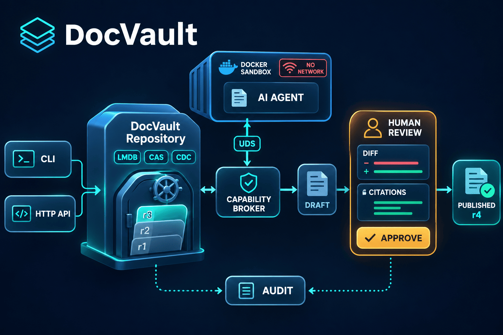

# DocVault

     



Версионированное хранилище документов с доказуемой целостностью: OCC/CAS на ревизии `head`, changesets, CDC для blob, HTTP API и CLI. Автономный агент правит черновик в Docker-песочнице через capability broker; человек утверждает публикацию с проверкой цитат из исходных байтов (HITL).

## Возможности

- LMDB-хранилище с оптимистичным контролем на `head` (без потери обновлений при конкуренции).
- Changesets и publish с CAS; CLI `dv` и REST API.
- Buzhash CDC и дедупликация крупных blob.
- FastAPI: changesets, documents, runs, audit; `Idempotency-Key` на мутациях.
- Capability broker (UDS) и Docker sandbox (`network none`) для кода агента.
- Evidence и claims; слабый support -> human review; UI на `/ui`.

## Архитектурные принципы

- **Один доменный слой** - `Repository` + LMDB для CLI, API и broker; агент не читает LMDB напрямую.
- **CAS на head** - publish только при совпадении ожидаемой ревизии.
- **Изоляция агента** - запись только через capability token и broker.
- **HITL** - publish после вердикта с проверкой, что цитата - подстрока bytes по `source_ref` (полной антигаллюцинации LLM нет).
- **Audit** - значимые события, включая HITL, в журнале LMDB.

## Tech Stack

Python 3.13, [uv](https://docs.astral.sh/uv/), FastAPI, LMDB, structlog, Docker / Docker Compose, pytest, ruff, mypy.

## Quick Start

```bash
git clone git@github.com:MrGrose/docvault.git
cd docvault
uv sync
make lint && make test
make demo-1
export DOCVAULT_CAPABILITY_SECRET=dev-demo-secret && make demo-agent
make demo-hitol
```

Для HITL-демо:

```bash
export DOCVAULT_REPO=./data/hitol-repo
uv run python -m cli.dv --path "$DOCVAULT_REPO" init
uv run uvicorn main:app --app-dir src --port 8080
# UI: http://127.0.0.1:8080/ui/
make demo-hitol
```

## Demos

| Команда | Что показывает |
|---------|----------------|
| `make demo-1` | LMDB, CAS, CLI, concurrent writers |
| `make demo-agent` | Broker UDS, sandbox, agent pipeline |
| `make demo-hitol` | Evidence, HITL UI, runs, audit |

Опционально: `make test-fault` (Docker, отдельный CI job).

## API

Основные группы: **changesets** (create, write doc, publish), **docs**, **runs** (pending, verdicts), **audit**. На мутациях - заголовок `Idempotency-Key`.

Интерактивная схема: OpenAPI на `http://127.0.0.1:8080/docs` при запущенном сервере.

## Development

```bash
make lint          # ruff + mypy src
make test          # pytest (unit + integration + BDD)
uv run pytest tests/bdd/ -q
uv run pytest --cov=src tests/
```

Перед merge: тесты и линтер зеленые локально и в CI.

### `scripts/`

Вспомогательные сценарии для демо и локальных замеров (не часть runtime `src/`). Демо-шеллы вызываются из `make demo-*`; остальное запускается вручную.

| Файл | Назначение |
|------|------------|
| `demo_1.sh` | LMDB, CAS, параллельные writers через CLI |
| `demo_agent.sh` | broker UDS, sandbox, agent pipeline |
| `demo_hitol.sh` | HITL: поднимает сценарий и вызывает клиент |
| `hitol_demo_client.py` | HTTP-клиент для HITL-демо (runs, verdict, publish) |
| `bench_cdc.py` | бенч Buzhash CDC и fixed-chunk baseline на тестовых blob |

Запуск бенча: `uv run python scripts/bench_cdc.py`.

## Architecture

На хосте: API, CLI, broker и LMDB. Агент в контейнере без сети обращается к broker по UDS; broker пишет в тот же `Repository`, что и API.

Подробно: компоненты, поток от агента до publish, хранение, безопасность и ограничения реализации - **[docs/architecture.md](docs/architecture.md)**.