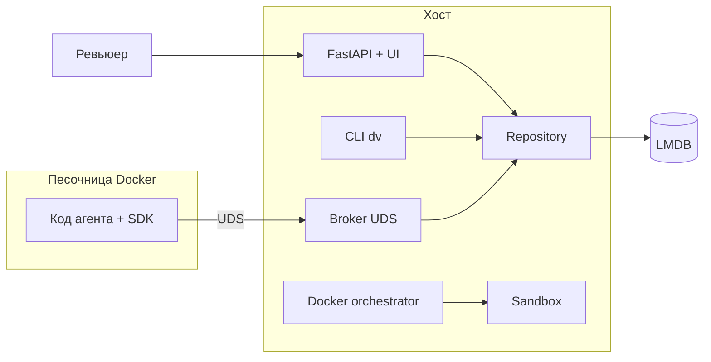
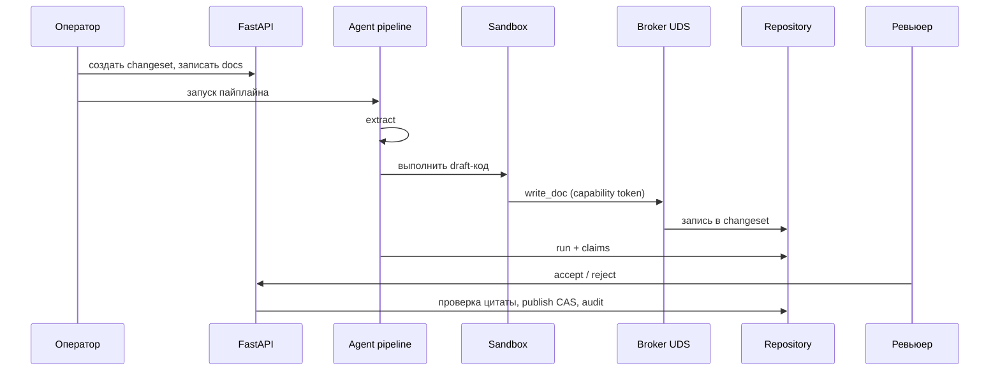

# Архитектура DocVault

Однопользовательское хранилище документов с версионированием на **LMDB**, оптимистичным контролем на `head` (CAS) и контуром, в котором **AI-агент** меняет черновик в **изолированной песочнице**, а **человек** утверждает публикацию с проверкой **цитат** из исходных байтов.

## Архитектурная идея

- **Единый доменный слой** (`Repository` + LMDB) обслуживает CLI, HTTP API и capability broker; агент **не** имеет прямого доступа к базе.
- **Changeset** - единица черновика; публикация поднимает ревизию `head` только при успешном CAS.
- **Агент** пишет в хранилище только через **SDK -> UDS broker -> Repository** с **capability token** (пути и операции).
- **HITL**: результат агента - **run** с **claims** (`source_ref`, evidence, `support`); при publish проверяется, что цитата - подстрока исходного файла.

## Архитектура системы

Граница доверия: LMDB и `docker.sock` только на хосте; контейнер агента без сети и без LMDB.

## Основные компоненты

| Компонент | Где | Ответственность |
|-----------|-----|-----------------|
| **Domain store** (`core/storage`, `core/kv`) | Хост | LMDB, ключи `meta:head`, `cs:*`, `blob:*`, `idem:*`, `audit:*`, `run:*` |
| **Repository** | Хост | Changeset, publish с CAS, docs в cs, blobs, audit, runs, idempotency |
| **CDC (Buzhash)** | Хост | Чанкование blob, дедупликация чанков |
| **CLI `dv`** | Хост | `init`, `write`, `commit`, `publish` |
| **FastAPI** | Хост | REST: changesets, docs, runs, audit; idempotency middleware |
| **UI** | Хост | Pending runs на `/ui` |
| **Agent pipeline** | Хост | extract -> draft (sandbox) -> validate -> claims |
| **Broker** | Хост | UDS: проверка capability token, `write_doc` |
| **Sandbox** | Контейнер | `network none`, лимит pids, UDS к broker |
| **SDK client** | Контейнер | Вызовы broker из кода агента |

Модули в `src/` (`api`, `broker`, `agent`, `sandbox`, `core`, `cli`), без отдельных деплоев на capability.

## Поток обработки документа

| Шаг | Действие |
|-----|----------|
| 1 | Инициализация репозитория и changeset (CLI или API) |
| 2 | Исходные файлы в changeset (`write` / PUT doc) |
| 3 | Extract - чтение путей и содержимого из cs |
| 4 | Draft - Python агента в Docker sandbox |
| 5 | SDK -> broker -> `write_doc` (после проверки token) |
| 6 | Validate - ошибки sandbox |
| 7 | Claims с evidence и `source_ref` |
| 8 | Run в ожидании ревью |
| 9 | Verdict в UI или `POST /runs/{id}/verdicts` |
| 10 | Accept: проверка подстроки цитаты; publish с CAS на `head` |

Прямой HTTP file-mode агента без sandbox в демо не используется. Антигаллюцинация LLM не гарантируется; при accept проверяется только буквальная цитата.

## Хранение и версионирование

- **Space** (по умолчанию `docvault`) и **`meta:head`** с монотонным `revision`.
- **Changeset** (`cs:{id}`): метаданные и дерево документов; publish при `expected_head` (конфликт -> 409).
- **Blob store** + **CDC** для крупного содержимого.
- **Idempotency-Key** на мутациях API.
- **Audit** в LMDB, в том числе события HITL publish.

CLI и API используют один путь данных (`DOCVAULT_PATH` / env).

## Безопасность

| Механизм | Поведение |
|----------|-----------|
| Capability token | HMAC (`DOCVAULT_CAPABILITY_SECRET`): space, префиксы путей, ops |
| Broker UDS | Единственный путь sandbox -> LMDB для `write_doc` |
| Docker sandbox | `network_mode=none`, cgroup pids |
| docker.sock | Только на хосте (orchestrator) |
| Секреты | Только из env |

## Ограничения и особенности реализации

- Один основной space; полный lifecycle draft/published для нескольких окружений не реализован (interim: статус на changeset).
- Записи broker и часть API могут идти в **разных** LMDB write txn; publish, idempotency outcome и audit HITL на API стараются объединять в одну write txn.
- Плоские пакеты в `src/`, а не отдельные сервисы на каждый capability-модуль.