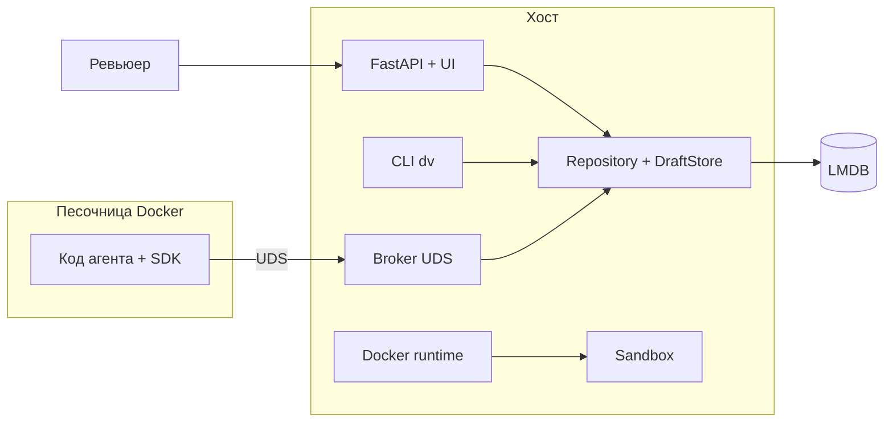

# Архитектура DocVault

Однопользовательское хранилище документов на LMDB: изолированные черновики, неизменяемые changesets, публикация через CAS, проверка цитат и human-in-the-loop. Агент работает в песочнице без сети и пишет только через broker.

## Принципы

- Один доменный слой `Repository` обслуживает CLI, HTTP API и broker. Прямых записей в LMDB вне его нет.
- Черновик принадлежит автору и имеет собственный id и базовую ревизию. Общей рабочей копии на space нет.
- Changeset создается только при публикации и после этого не меняется.
- Публикация атомарна: changeset, CAS на `head`, provenance, audit и idempotency outcome пишутся в одной транзакции.
- Утверждение проверяется по трем независимым результатам: evidence, binding к измененному фрагменту, support как эвристика. Статус `grounded` не значит "истинно", смысл проверяет человек.
- API слушает только localhost, удаленный доступ через SSH tunnel. Песочница без сети, broker доступен только по UDS.

## Схема

## Компоненты

| Компонент | Где | Ответственность |
|-----------|-----|-----------------|
| `core/kv.py` | Хост | LMDB, `get`, `put_cas`, `scan`, `snapshot`, размер карты из env |
| `DraftStore` | Хост | Черновики: создание, пути, rebase, статус, владелец |
| `ChangesetStore` | Хост | Публикация черновика, CAS, provenance, audit |
| `BlobStore` и CDC | Хост | Чанки, дедупликация, деревья, diff |
| `Repository` | Хост | Единая точка записи для API, CLI и broker |
| CLI `dv` | Хост | `init`, `write`, `commit`, `log`, `diff`, `checkout`, флаг `--draft` |
| FastAPI | Хост | changesets, docs, runs, audit, UI, idempotency |
| Broker | Хост | Проверка capability и запись в конкретный черновик |
| Sandbox | Контейнер | `network none`, лимиты памяти, CPU, pids, read-only rootfs, non-root |

## Поток

| Шаг | Действие |
|-----|----------|
| 1 | `POST /changesets` создает черновик: id, владелец, `base_head` |
| 2 | Запись документа в черновик через API, CLI или broker |
| 3 | Агент пишет код, код исполняется в песочнице и вызывает broker |
| 4 | Broker проверяет токен: space, draft_id, путь, операция, срок |
| 5 | Создается run с claims: путь, текст, цитата, источник, диапазон |
| 6 | Evidence проверяется по байтам, binding по измененному фрагменту, support как подсказка |
| 7 | Ревьюер видит diff, цитаты и статусы в UI |
| 8 | Вердикт accept сверяет `content_hash` с текущим черновиком, затем публикует, reject закрывает run |
| 9 | Публикация: `expected_head == draft.base_head`, CAS, audit и provenance в одной транзакции |

## Данные

| Ключ | Значение | Изменяемость |
|------|----------|--------------|
| `draft:{id}` | id, space, owner, base_head, parent_draft, paths, conflicts, status | пока открыт |
| `cs:{id}` | parent, base_head, tree_hash, author, approver, run_id, provenance, draft_id | никогда |
| `head:{space}` | id опубликованного changeset | только CAS |
| `blob:{sha}` | список чанков | никогда |
| `chunk:{sha}` | байты чанка | никогда |
| `tree:{sha}` | путь к blob | никогда |
| `idem:{scope}` | fingerprint, статус, ответ | однократно, в одной транзакции с эффектом |
| `audit:{seq}` | событие, автор, утвердивший, draft_id, changeset_id, tree_hash | append-only |
| `run:{id}` | прогон, claims, статусы, `content_hash` черновика, вердикт | до вердикта |

Публикация собирает дерево как базовое дерево черновика плюс его пути. Публиковать только пути черновика нельзя: тогда из истории пропадают нетронутые файлы.

## Claims

- `evidence`: источник доступен, цитата совпадает с байтами, `byte_range` совпадает, если задан.
- `binding`: путь входит в изменения, текст найден в конкретном измененном абзаце. Для `delete` текст есть в удаленном фрагменте и отсутствует в новом.
- `support`: пересечение токенов, только подсказка.

Итог: `blocked` при провале evidence, `needs_human` при провале binding или слабом support, `grounded` когда evidence и binding прошли. Нормализация текста сжимает пробелы и CRLF/LF, регистр и пунктуация сохраняются.

## Безопасность

| Механизм | Поведение |
|----------|-----------|
| Capability token | HMAC: space, draft_id, префиксы путей, ops, срок, jti |
| Отзыв token | `revoked:{jti}` в LMDB, проверка в broker |
| API auth | Опциональный bearer token из env, кроме /health, /ui, /docs |
| Отпечаток токена | sha256, первые 16 символов |
| Broker UDS | Единственный путь из песочницы к данным |
| Docker sandbox | `network none`, память, CPU, `pids_limit`, read-only rootfs, tmpfs, non-root, `cap_drop=ALL` |
| API | Только `127.0.0.1`, без аутентификации, удаленный доступ через SSH tunnel |
| Секреты | Только из env |

## Ограничения

- Одна нода и один писатель LMDB; конкурентность держится на CAS, а не на параллельной записи.
- Размер карты задается при открытии через `DOCVAULT_MAP_SIZE`, на лету не растет.
- Rebase создает новый черновик и помечает конфликтные пути; трехстороннего merge нет.
- Если черновик изменили после создания run, accept возвращает 409: старые проверки claims к новому тексту не применяются.
- Идемпотентные ключи хранятся без TTL, журнал аудита только дописывается.
- Отзыв токенов есть по `jti`, привязки к run нет; токен ограничен space, draft_id, путями и сроком.
- Полнотекстового поиска нет.
- Draft в текущем коде это фиксированный шаблон; стадия с моделью подключается отдельно.
